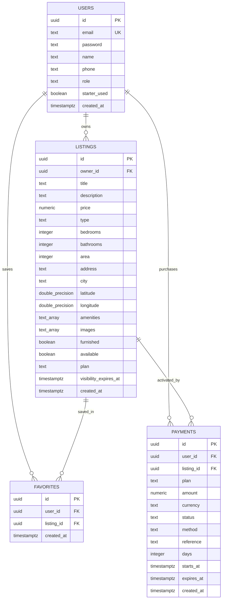

# ⚡ RentHub Backend API

> **A high-performance, serverless edge API powering the RentHub ecosystem. Built on Cloudflare Workers for sub-10ms global edge latency, with Supabase PostgreSQL for relational persistence, Supabase Storage for property photo CDN distribution, and Google Maps API for geocoding.**

[](https://workers.cloudflare.com)
[](https://supabase.com)
[](https://developers.google.com/maps)
[](https://developers.cloudflare.com/workers/wrangler/)
[](LICENSE)

---

## 📌 Executive Summary & Architecture 

In traditional housing rental platforms, backends suffer from heavy server maintenance costs, slow cold-starts, bloated monolithic architectures, and unmaintained ghost listings. 

**RentHub Backend** resolves these challenges with an ultra-lightweight, edge-native architecture:
1. **Serverless Edge Compute (Cloudflare Workers):** Runs in 300+ edge locations worldwide. Zero cold starts, millisecond responses, and automatic horizontal scaling.
2. **Automated Visibility Expiration (Anti-Ghosting Engine):** Listings are served to public renter feeds *strictly* while their visibility pack window (`visibility_expires_at > NOW()`) is active. Once expired, listings are automatically withheld from search results without requiring heavy recurring cron jobs.
3. **Decoupled Relational Persistence:** Directly leverages Supabase PostgreSQL with custom composite spatial indexes (`latitude, longitude`) and timestamp indexes (`visibility_expires_at`) for fast geo-queries.
4. **Direct Cloud Storage Gateway:** Receives multipart image payloads directly at the edge and streams them into Supabase Storage buckets, returning CDN-ready public URLs with on-demand image resizing compatibility.

---

## 🏛️ System Architecture & Data Flow

```mermaid
graph TD
    subgraph Clients
        App["📱 RentHub Mobile App<br/>(React Native / Expo)"]
        Admin["💻 RentHub Admin Panel<br/>(Vite / React 19 SPA)"]
    end

    subgraph Edge Layer (Cloudflare Workers)
        Worker["⚡ houserent-backend<br/>(Cloudflare Worker)"]
        Router["🔀 Modular Route Handler<br/>(auth, listings, packs, payments, maps, uploads)"]
    end

    subgraph Cloud Infrastructure
        DB[("🐘 Supabase PostgreSQL<br/>(users, listings, favorites, payments)")]
        Storage["🗄️ Supabase Storage<br/>(Bucket: listing-images)"]
        GMaps["🗺️ Google Maps Geocoding API"]
        AdminFunc["🔒 Supabase Edge Function<br/>(admin-api - Service Role)"]
    end

    App -->|"HTTP REST (/api/*)"| Worker
    Worker --> Router
    Router -->|"SQL / PostgREST (anon key)"| DB
    Router -->|"Multipart Stream"| Storage
    Router -->|"Address to Lat/Lng"| GMaps

    Admin -->|"Admin Ops (Service Role)"| AdminFunc
    AdminFunc -->|"Full DB Management"| DB
```

---

## 💳 Business Model & Visibility Pack Engine

Property owners pay for **visibility duration** rather than permanent slots. This guarantees that every property visible to renters is current, responsive, and available.

### 1. Pack Catalog

| Pack Tier | Identifier | Price | Duration | Target Use Case |
| :--- | :---: | :---: | :---: | :--- |
| 🎁 **Starter Pack** | `starter` | **₹0 (Free)** | **30 Days** | Auto-granted on owner's **1st listing** (one-time onboarding incentive) |
| ⚡ **Basic Pack** | `basic` | **₹99** | **7 Days** | Quick turnover boost for urgent room vacancies |
| 🌟 **Pro Monthly** | `pro` | **₹299** | **30 Days** | Standard 1-month continuous visibility *(Most Popular)* |
| 💎 **Ultra 3-Month** | `ultra` | **₹599** | **90 Days** | Long-term high-value apartments & student hostels |

### 2. State & Lifecycle Rules
- **First Property Grace:** When an owner creates their first property, the backend checks `users.starter_used`. If `false`, it auto-applies the 30-day Starter Pack, marks `starter_used = true`, and sets `visibility_expires_at = NOW() + 30 days`.
- **Subsequent Listings:** Any subsequent listing by that owner starts with `visibility_expires_at = null` and `needs_pack = true` (hidden from public renter queries).
- **Time Stacking on Renewal:** If an owner renews or buys a new pack while their current pack is still active, the new days are **stacked onto the remaining expiry date** rather than resetting from today:
  $$\text{New Expiry} = \max(\text{Current Expiry}, \text{NOW()}) + \text{Pack Days}$$
- **Public Query Filter:** All public endpoints (`/api/listings`, `/api/listings/nearby`, `/api/listings/favorites`) enforce:
  ```sql
  WHERE available = true AND visibility_expires_at > NOW()
  ```
- **Demo Payment Gateway:** The endpoint `POST /api/payments/checkout` executes a payment simulation, returns an audit reference (`DEMO-XXXXXX`), activates the pack, and writes an immutable transaction log to the `payments` table.

---

## 🗄️ Database Schema & RLS Architecture

The database is built on Supabase PostgreSQL. Migration scripts are located in [`database-migrations/`](file:///home/barry/Desktop/hackaton/houserent-backend/database-migrations).

### Entity Relationship Diagram



### Key Performance Indexes
- **Spatial Geo-Search:** `CREATE INDEX listings_geo_idx ON listings (latitude, longitude);`
- **Visibility Timestamp Filter:** `CREATE INDEX listings_visibility_idx ON listings (visibility_expires_at);`
- **Owner Relationship Lookups:** `CREATE INDEX listings_owner_idx ON listings (owner_id);`
- **Payment History Ledger:** `CREATE INDEX payments_user_idx ON payments (user_id);`

### Row Level Security (RLS) Policy
The Cloudflare Worker functions as the trusted edge orchestrator and uses the Supabase anon key to query the database. RLS policies explicitly grant the `anon` role necessary CRUD access to `users`, `listings`, `favorites`, `payments`, and `storage.objects`, while business rules (e.g. preventing clients from modifying `visibility_expires_at` during normal PUT updates) are strictly enforced in the Worker API layer.

---

## 📁 Project Directory Structure

```
houserent-backend/
├── wrangler.toml               # Cloudflare Workers configuration (compatibility, routes, vars)
├── package.json                # Project dependencies (@supabase/supabase-js, wrangler)
├── .dev.vars                   # Local environment secrets (SUPABASE_URL, API keys)
├── database-migrations/
│   ├── schema.sql              # Initial database schema, RLS policies, and storage bucket setup
│   └── 002_packs_and_payments.sql # Migration adding packs, starter tracking, and payments ledger
└── src/
    ├── index.js                # Main Worker entry point: CORS preflight & route dispatching
    ├── lib/
    │   ├── plans.js            # Visibility pack catalog, duration math, and status helpers
    │   ├── response.js         # Standard JSON response, CORS headers & error formatters
    │   └── supabase.js         # Factory creating Supabase clients from Worker environment bindings
    └── routes/
        ├── auth.js             # User registration & login handlers
        ├── favorites.js        # User bookmark retrieval and toggling
        ├── listings.js         # Public search, owner dashboard, nearby geo & CRUD endpoints
        ├── maps.js             # Google Maps Geocoding API proxy
        ├── payments.js         # Demo payment simulation, pack activation & payment audit
        ├── plans.js            # Pack catalog & owner aggregate billing status endpoints
        └── uploads.js          # Multipart property photo upload to Supabase Storage
```

---

## 🔌 API Endpoint Reference

All endpoints return standard JSON responses and include permissive CORS headers (`Access-Control-Allow-Origin: *`) for web and mobile clients.

### 1. 🛡️ Authentication (`src/routes/auth.js`)

#### `POST /api/auth/register`
Creates a new tenant or property owner account.
```json
// Request Body
{
  "email": "owner@example.com",
  "password": "secretPassword123",
  "name": "Jane Doe",
  "phone": "+919876543210",
  "role": "owner" // "owner" or "tenant" (defaults to "tenant")
}

// Response (201 Created)
{
  "user": {
    "id": "8a06e903-8fa9-4a9f-864b-741ef024bb1f",
    "email": "owner@example.com",
    "name": "Jane Doe",
    "phone": "+919876543210",
    "role": "owner",
    "starter_used": false,
    "created_at": "2026-10-16T12:00:00.000Z"
  },
  "starter": {
    "id": "starter",
    "name": "Starter Pack",
    "price": 0,
    "days": 30
  }
}
```

#### `POST /api/auth/login`
Validates credentials and returns user identity.
```json
// Request Body
{
  "email": "owner@example.com",
  "password": "secretPassword123"
}

// Response (200 OK)
{
  "user": {
    "id": "8a06e903-8fa9-4a9f-864b-741ef024bb1f",
    "email": "owner@example.com",
    "name": "Jane Doe",
    "role": "owner",
    "starter_used": true
  }
}
```

---

### 2. 🏠 Listings (`src/routes/listings.js`)

#### `GET /api/listings`
Returns all public listings whose visibility pack is currently active (`visibility_expires_at > NOW()`).

| Query Parameter | Type | Description |
| :--- | :---: | :--- |
| `q` | `string` | Case-insensitive search on title, address, or city |
| `type` | `string` | Filter by `apartment`, `hostel`, or `house` |
| `minPrice` | `number` | Minimum monthly rent in INR |
| `maxPrice` | `number` | Maximum monthly rent in INR |
| `bedrooms` | `number` | Minimum number of bedrooms |

```json
// Response (200 OK)
{
  "listings": [
    {
      "id": "3c7b396e-e9fa-476b-9443-41bbd51be1a2",
      "owner_id": "8a06e903-8fa9-4a9f-864b-741ef024bb1f",
      "title": "Serene 2BHK Near Indiranagar Metro",
      "description": "Sunlit apartment with spacious balcony and modern kitchen.",
      "price": 32000,
      "type": "apartment",
      "bedrooms": 2,
      "bathrooms": 2,
      "area": 1150,
      "address": "100ft Road, Indiranagar",
      "city": "Bangalore",
      "latitude": 12.9784,
      "longitude": 77.6408,
      "amenities": ["WiFi", "AC", "Parking", "Security"],
      "images": [
        "https://whpeabltxdrtjkkckhqo.supabase.co/storage/v1/object/public/listing-images/17724500-photo.jpg"
      ],
      "furnished": true,
      "available": true,
      "plan": "pro",
      "plan_name": "Pro",
      "visibility_expires_at": "2026-11-15T12:00:00.000Z",
      "is_visible": true,
      "days_left": 30,
      "pack_status": "active"
    }
  ]
}
```

#### `GET /api/listings/nearby`
Finds visible listings within a given radius using bounding-box latitude/longitude filtering.
- **Parameters:** `lat` (float), `lng` (float), `radius` (km, default: 10)

#### `GET /api/listings/owner/:ownerId`
Retrieves all listings owned by a specific owner (including hidden, expired, and unpaid listings) with comprehensive pack metadata for their management dashboard.

#### `GET /api/listings/favorites/:userId`
Returns fully hydrated listing objects favorited by the specified user, ensuring expired listings are filtered out.

#### `POST /api/listings`
Creates a new property listing. If it is the owner's first listing, it auto-claims the 30-day free Starter Pack.
```json
// Request Body
{
  "owner_id": "8a06e903-8fa9-4a9f-864b-741ef024bb1f",
  "title": "Cozy Studio near Tech Park",
  "description": "Quiet living space ideal for working professionals.",
  "price": 18000,
  "type": "apartment",
  "bedrooms": 1,
  "bathrooms": 1,
  "area": 550,
  "address": "Outer Ring Road, Bellandur",
  "city": "Bangalore",
  "latitude": 12.9260,
  "longitude": 77.6762,
  "amenities": ["WiFi", "Power Backup", "Security"],
  "images": ["https://.../listing-images/sample.jpg"],
  "furnished": true
}

// Response (201 Created)
{
  "listing": { "id": "...", "title": "Cozy Studio near Tech Park", "is_visible": true, "days_left": 30 },
  "pack_granted": { "id": "starter", "name": "Starter Pack", "days": 30 },
  "needs_pack": false
}
```

#### `PUT /api/listings/:id`
Updates an existing listing's information. Security filter strips any attempts to modify `plan` or `visibility_expires_at` directly.

#### `DELETE /api/listings/:id`
Deletes a property listing by ID.

---

### 3. 🖼️ Image Uploads (`src/routes/uploads.js`)

#### `POST /api/upload/image`
Directly receives a `multipart/form-data` payload containing an image file, generates a collision-free filename, streams it to the Supabase Storage `listing-images` bucket, and returns its public HTTPS URL.
```json
// Form Data: file = <binary image file>

// Response (201 Created)
{
  "url": "https://whpeabltxdrtjkkckhqo.supabase.co/storage/v1/object/public/listing-images/1772458921-a7bc.jpg"
}
```

---

### 4. 🗺️ Geocoding (`src/routes/maps.js`)

#### `GET /api/maps/geocode?address=Address+Text`
Proxies address geocoding through Google Maps Geocoding API securely from the edge without exposing the Google Cloud server key to client bundles.
```json
// Response (200 OK)
{
  "latitude": 12.9715987,
  "longitude": 77.5945627,
  "formatted_address": "Bengaluru, Karnataka, India"
}
```

---

### 5. ❤️ Favorites (`src/routes/favorites.js`)

- `GET /api/favorites/:userId` — Returns an array of listing UUIDs saved by the user: `{"favorites": ["uuid-1", "uuid-2"]}`.
- `POST /api/favorites/toggle` — Toggles bookmark state for `{ "user_id": "...", "listing_id": "..." }`; returns `{"favorited": true}` or `{"favorited": false}`.

---

### 6. 📦 Plans & Packs (`src/routes/plans.js`)

- `GET /api/plans` — Returns the pack catalog with pricing and duration. Appending `?userId=<uuid>` adds the `starter_available` boolean.
- `GET /api/packs/:userId` — Aggregates an owner's complete portfolio billing state: total listings, active visible listings, hidden listings, next upcoming expiration timestamp, days remaining, and total amount spent.

---

### 7. 💳 Payments & Checkout (`src/routes/payments.js`)

#### `POST /api/payments/checkout`
Executes a simulated payment transaction, calculates new or stacked expiry dates, updates the listing visibility, and logs the transaction.
```json
// Request Body
{
  "user_id": "8a06e903-8fa9-4a9f-864b-741ef024bb1f",
  "listing_id": "3c7b396e-e9fa-476b-9443-41bbd51be1a2",
  "plan": "pro",
  "method": "demo"
}

// Response (201 Created)
{
  "ok": true,
  "pack": { "id": "pro", "name": "Pro", "price": 299, "days": 30 },
  "listing": {
    "id": "3c7b396e-e9fa-476b-9443-41bbd51be1a2",
    "is_visible": true,
    "visibility_expires_at": "2026-11-15T12:00:00.000Z",
    "days_left": 30,
    "pack_status": "active"
  },
  "payment": {
    "id": "f5e929b1-0941-479c-b847-b8924b17aa98",
    "amount": 299,
    "currency": "INR",
    "status": "paid",
    "reference": "DEMO-M78B3F-A29C",
    "days": 30
  }
}
```

#### `GET /api/payments/:userId`
Returns the historical payment ledger for the requested owner.

---

### 8. 🩺 Health Check (`src/index.js`)

#### `GET /api/health`
Returns runtime status and server timestamp:
```json
{
  "status": "ok",
  "timestamp": "2026-10-16T12:00:00.000Z"
}
```

---

## 🛠️ Local Development & Testing

### 1. Prerequisites
- [Node.js](https://nodejs.org/) v18 or later
- [Cloudflare Wrangler CLI](https://developers.cloudflare.com/workers/wrangler/): `npm install -g wrangler`
- A [Supabase project](https://supabase.com) with database migrations applied
- A [Google Maps API key](https://console.cloud.google.com/) with Geocoding API enabled

### 2. Setup
```bash
# Clone and enter the backend directory
cd houserent-backend

# Install dependencies
npm install
```

### 3. Local Environment Variables
Create or verify `.dev.vars` in the root folder:
```ini
SUPABASE_URL=https://your-project.supabase.co
SUPABASE_ANON_KEY=your-supabase-anon-key
GOOGLE_MAPS_API_KEY=your-google-maps-api-key
```

### 4. Start Local Worker Dev Server
```bash
npm run dev
# Running at http://localhost:8787
```

### 5. Test with cURL
```bash
# 1. Health check
curl http://localhost:8787/api/health

# 2. Fetch all visible listings
curl http://localhost:8787/api/listings

# 3. Filter apartments under ₹30,000 in Bangalore
curl "http://localhost:8787/api/listings?city=Bangalore&type=apartment&maxPrice=30000"

# 4. Inspect pack catalog
curl http://localhost:8787/api/plans

# 5. Geocode an address
curl "http://localhost:8787/api/maps/geocode?address=Koramangala+Bangalore"
```

---

## ☁️ Production Deployment to Cloudflare Workers

### 1. Authenticate Wrangler
```bash
wrangler login
```

### 2. Configure Production Secrets
Set sensitive credentials securely in Cloudflare's encrypted secret store:
```bash
wrangler secret put SUPABASE_URL
wrangler secret put SUPABASE_ANON_KEY
wrangler secret put GOOGLE_MAPS_API_KEY
```

### 3. Deploy
```bash
npm run deploy
# Deployed to https://houserent-backend.<subdomain>.workers.dev
```

---

## 🔒 Security & Reliability Architecture

- **CORS Preflight Compliance:** Handles `OPTIONS` preflight requests immediately at the edge with HTTP 204 No Content.
- **Edge Error Boundaries:** All route executions are wrapped in `try/catch` boundaries ensuring consistent `{ "error": "Message" }` payloads and HTTP status codes (`400`, `401`, `403`, `404`, `409`, `500`).
- **Billing Field Immutability:** Clients cannot artificially extend listing visibility via `PUT /api/listings/:id` because the handler explicitly strips `plan` and `visibility_expires_at` prior to database execution.
- **Production Password Transition Note:** For the hackathon demonstration, passwords in `users` are validated directly; for high-security enterprise production, sign-ins can be routed seamlessly through **Supabase Auth** or Argon2id edge workers.

---

## 👥 Hackathon Team

Developed with passion by the **RentHub Team**.
- **Edge API:** Cloudflare Workers (JavaScript ES Modules)
- **Database & Storage:** Supabase PostgreSQL & Storage CDN
- **Geocoding:** Google Maps API
# renthub-backend
